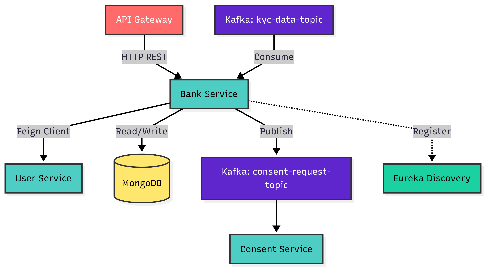
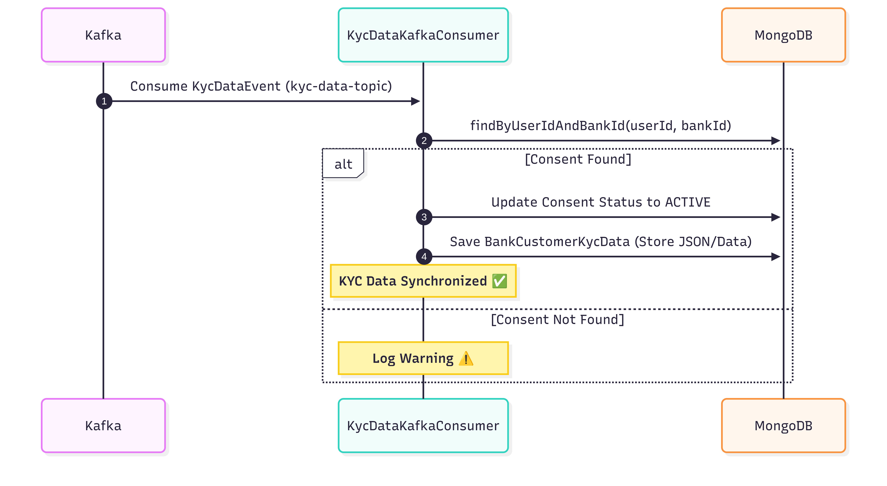
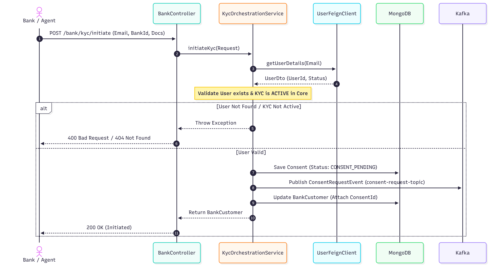

# 🏦 Bank Service

## 📌 Overview
The **Bank Service** is a core microservice in the Centralized KYC System. It acts as the interface for banking institutions to interact with the KYC platform. Its primary responsibilities include:
*   **Bank Onboarding & Profile Management**: Registering and managing bank details.
*   **KYC Initiation**: Initiating consent-based KYC verification requests for customers.
*   **Consent Management**: Tracking the status of customer consents (Pending, Approved, Active).
*   **KYC Data Storage**: Securely storing customer KYC information (e.g., hashed/encrypted data or metadata) tailored for the bank's records.

---

## 🛠️ Tech Stack
*   **Framework**: Spring Boot 3.x
*   **Database**: MongoDB (Polyglot persistence for JSON-based KYC data & history)
*   **Messaging**: Apache Kafka (Event-driven consent requests and data synchronization)
*   **Client**: Spring Cloud OpenFeign (Synchronous lookup from User Service)
*   **Security**: Spring Security + JWT Authentication (Service-level verification)

---

## 🏗️ System Architecture & Interactions

The Bank Service interacts with the API Gateway, Discovery Server, and other microservices via synchronous and asynchronous communication models.




---

## 🔄 Key Workflows

### 1️⃣ KYC Initiation Flow
When a bank initiates a KYC request for a customer, it goes through a validation and event-publishing sequence.



### 2️⃣ KYC Data Sync Flow (Completion)
Asynchronous updates when consent is processed and KYC data is generated.



---

## 🔌 API Endpoints

All endpoints are prefixed with `/bank/kyc` and routed via the **API Gateway (Port 8083)** path `/bank/**`.

| Method | Endpoint | Access Role | Description |
| :--- | :--- | :--- | :--- |
| **POST** | `/initiate` | `BANK`, `BANK_AGENT` | Initiates a new KYC verification consent request. |
| **GET** | `/status/{userId}/{bankId}` | `BANK`, `BANK_AGENT`, `ADMIN` | Fetches the current KYC status of a customer. |
| **POST** | `/fetch/{userId}/{bankId}` | `BANK`, `BANK_AGENT` | Fetches synchronized KYC data. |
| **GET** | `/bank/profile` | `BANK`, `BANK_AGENT` | Retrieves the profile of the authenticated bank. |
| **GET** | `/customers/{bankId}` | `BANK`, `BANK_AGENT` | Lists all customers onboarded by the bank. |
| **GET** | `/consents/pending` | `BANK`, `BANK_AGENT` | Lists pending consent requests for the bank. |
| **GET** | `/consents/all/{bankId}` | `BANK`, `BANK_AGENT` | Lists all consents (history) for the bank. |
| **GET** | `/banks` | **Public** | Lists all registered banks (for dropdowns/selection). |
| **POST** | `/register` | **Public** | Registers a new Bank onboarding request. |
| **POST** | `/otp/request` | **Public** | Requests login OTP. |
| **POST** | `/otp/verify` | **Public** | Verifies OTP and completes login. |

---

## ⚙️ Configuration Hints
*   **Database**: Uses **MongoDB** for flexible audit logging and KYC artifact metadata storage.
*   **Security**: Validates tokens with a local `JwtAuthenticationFilter` utilizing the secret key configured in `application.properties`.

---

## 🚀 Running the Service
1.  Ensure **DiscoveryService** (Port 8761) and **Kafka** are running.
2.  Run the application using Maven:
    ```bash
    mvn spring-boot:run
    ```
