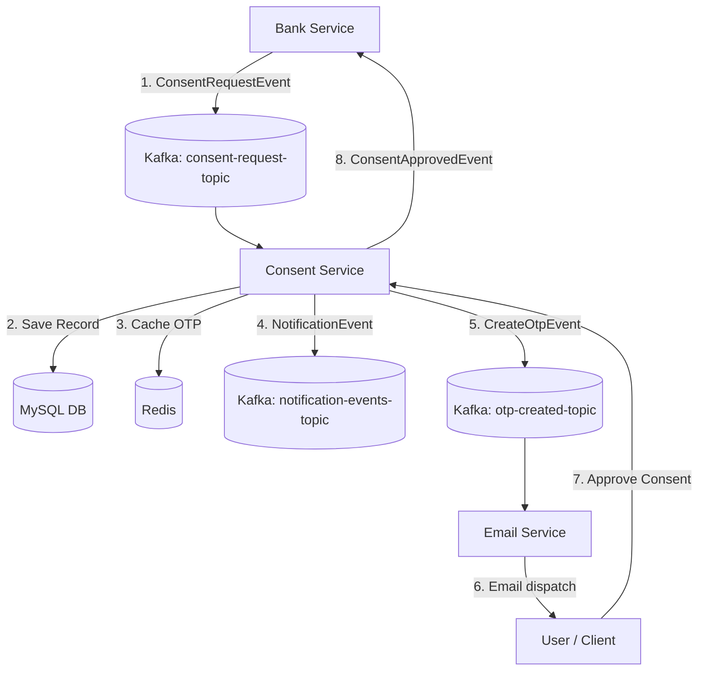
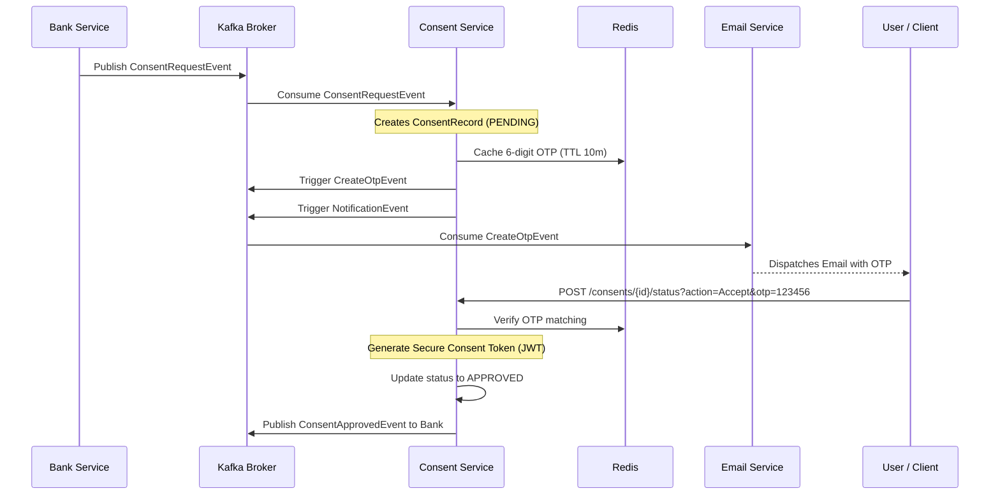

# Consent Service

The **Consent Service** is a core component of the Centralized KYC System. It manages the lifecycle of KYC consent requests initiated by Banks/Organizations seeking user data access, ensuring secure approval with OTP authentication.

---

## 🏗️ Architecture Layout

Below is a Mermaid chart describing the architecture and module relationships:



---

## 🔄 Lifecycle Sequence

The standard request-approval flow executing over event-driven hooks executed inside this service:



---

## 📌 Features

- **Event-Driven Intake**: Automatically processes incoming KYC requests without synchronous blocking setups.
- **Auto OTP Generation**: Immediately caches a Redis variable and triggers an `EmailService` endpoint dispatch for every request intakes.
- **Mapped URLs**: Forwards actionable endpoints to push Notification system redirects directly to approval hooks.
- **Secure Consent Token (JWT)**: Mints standard tokens bundling the absolute fields approved for secure downstream accessing workflows.

---

## 🛠️ API Endpoints

All endpoints use base routing prefix: `/consents`

| Endpoint | Method | Params | Description |
| :--- | :--- | :--- | :--- |
| `/request` | `POST` | `@RequestBody ConsentRequestDto` | (Internal/Bank trigger) Receives trigger requests. |
| `/send-otp/{consentId}` | `POST` | `@PathVariable UUID` | Manually triggers/resends the verification OTP. |
| `/approve/{consentId}` | `POST` | `@RequestParam String otp` | Approves and generates access JWT tokens. |
| `/reject/{consentId}` | `POST` | `@RequestParam String otp` | Rejects targeting consent scope. |
| `/{consentId}/status` | `POST` | `action=[Accept/Decline], otp=123456` | **Unified Endpoint**: Route unified form/link actions. |
| `/user/{userId}` | `GET` | `@PathVariable String` | Returns all consent records bound to a specific user. |

---

## ⚙️ Prerequisites Configuration (`application.yml`)

The following variables support JSON serialisation for `@KafkaListener` consumption securely:

```yaml
spring:
  kafka:
    consumer:
      bootstrap-servers: localhost:9092
      key-deserializer: org.apache.kafka.common.serialization.StringDeserializer
      value-deserializer: org.springframework.kafka.support.serializer.JsonDeserializer
      properties:
        spring.json.trusted.packages: "*"
```
