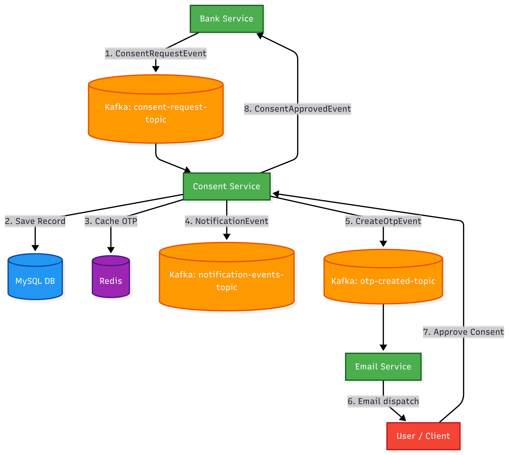
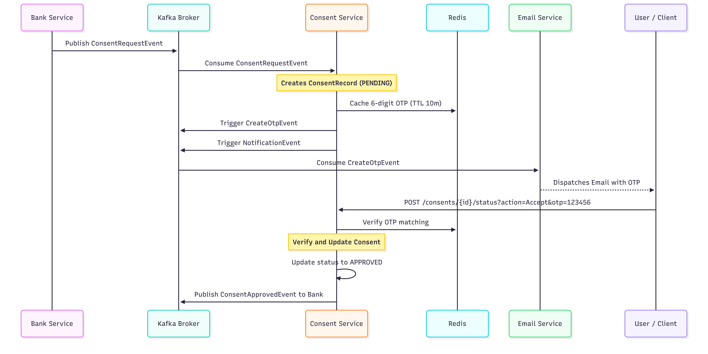

# 🛡️ Consent Service

## 📌 Overview
The **Consent Service** is a core component of the Centralized KYC System. It manages the lifecycle of KYC consent requests initiated by Banks/Organizations seeking user data access. Its primary responsibilities include:
*   **Consent Request Lifecycle**: Managing creation, approval, and expiration of user consents.
*   **OTP Verification**: Securely caching and verifying OTPs via Redis for approval actions.
*   **Notification Dispatch**: Triggering events for user and bank notifications upon status changes.
*   **Access Token Minting**: Generating secure assertions/records for downstream KYC access.

---

## 🛠️ Tech Stack
*   **Framework**: Spring Boot 4.x
*   **Database**: MySQL (Relational persistence for consent records)
*   **Caching**: Redis (For secure OTP caching with TTL)
*   **Messaging**: Apache Kafka (Event-driven notification and status updates)
*   **Client**: Spring Cloud OpenFeign (Synchronous user lookup)
*   **Security**: Spring Security + JWT

---

## 🏗️ System Architecture & Interactions

The Consent Service interacts with Kafka Brokers for asynchronous event consumptions and notifications, and provides REST endpoints for consent operations.




---

## 🔄 Key Workflows

### 1️⃣ Consent Request & Approval Flow
The standard request-approval flow executing over event-driven hooks inside this service.




---

## 🔌 API Endpoints

All endpoints are prefixed with `/consents` and usually routed via the **API Gateway (Port 8083)**.

| Method | Endpoint | Access Role | Description |
| :--- | :--- | :--- | :--- |
| **POST** | `/request` | `Public / Internal` | Receives trigger requests for consent. |
| **POST** | `/{consentId}/otp` | `Public` | Manually triggers/resends the verification OTP. |
| **POST** | `/{consentId}/approve` | `Public` | Approves consent using OTP. |
| **POST** | `/{consentId}/reject` | `Public` | Rejects consent scope using OTP. |
| **POST** | `/{consentId}/status` | `Public` | **Unified Endpoint**: Handle actions (Accept/Decline). |
| **GET** | `/user/{userId}` | `Public` | Returns all consent records bound to a specific user. |
| **GET** | `/` | `Public` | Returns details for a specific consent (User & Bank). |

---

## ⚙️ Configuration Hints
*   **Database**: Uses **MySQL** (`jdbc:mysql://localhost:3306/kyc_consent_db`) for consent records.
*   **Caching**: Uses **Redis** (Port 6379) for caching 6-digit OTPs with a 10-minute expiration.
*   **Security**: Validates requests based on token flow (Currently configured with `permitAll()` for local development).
*   **Encryption**: Utilizes `encryption.secret-key` for secure assertion triggers locally.

---

## 🚀 Running the Service
1.  Ensure **DiscoveryService** (Port 8761) and **Kafka** are running.
2.  Ensure **Redis** (Port 6379) is active and running.
3.  Run the application using Maven:
    ```bash
    mvn spring-boot:run
    ```
