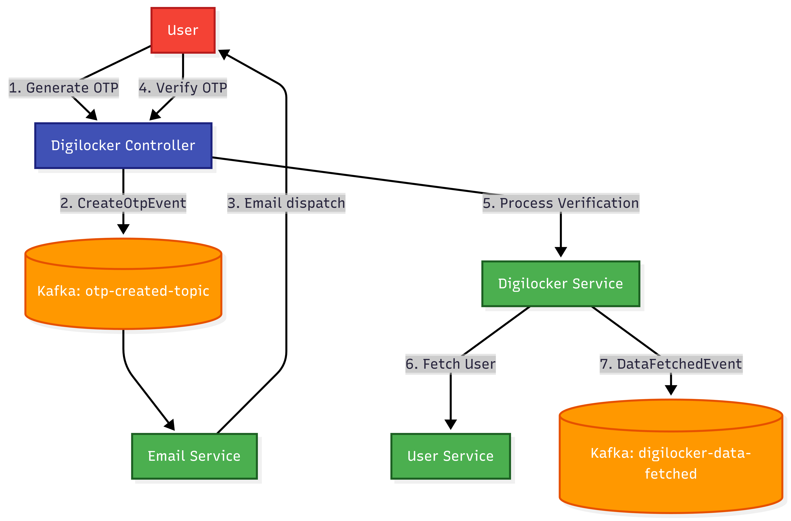
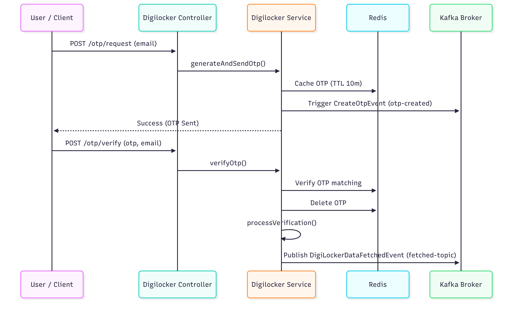

# 🛡️ DigiLocker Service

## 📌 Overview
The **DigiLocker Service** is a core component of the Centralized KYC System. It interacts with or simulates Government DigiLocker verification (Aadhaar/PAN) inside the platform. Its primary responsibilities include:
*   **OTP-Based Authentication**: Generating and verifying OTPs via Redis setup securely.
*   **Identity Data Fetches**: Processing triggers to seed Dummy KYC Data back downstream.
*   **Asynchronous Processing**: Producing descriptive results back over event setups effectively.

---

## 🛠️ Tech Stack
*   **Framework**: Spring Boot 3.x
*   **Database/Caching**: Redis (For secure session storage and OTP validation with TTL)
*   **Messaging**: Apache Kafka (Event-driven notification and data fetched triggers)
*   **Client**: Spring Cloud OpenFeign (Synchronous user lookup)
*   **Security**: Spring Security + JWT authentication

---

## 🏗️ System Architecture & Interactions

The DigiLocker Service interact updates components asynchronously over event broker setups.




---

## 🔄 Key Workflows

### 1️⃣ DigiLocker Verification Flow
The standard request-approval flow executing execution lifecycle executed inside this service.




---

## 🔌 API Endpoints

All endpoints are prefixed with `/api/digilocker` and usually routed via the **API Gateway (Port 8083)**.

| Method | Endpoint | Access Role | Description |
| :--- | :--- | :--- | :--- |
| **GET** | `/redirect` | `Public` | Simulates redirection response triggers to partner setups. |
| **POST** | `/otp/request` | `Public` | Initiates OTP request generation inside context limits. |
| **POST** | `/otp/verify` | `Public` | Validates accurate matching verifying downstream pipelines triggers. |

---

## ⚙️ Configuration Hints
*   **Caching**: Uses **Redis** (Port 6379) for caching 6-digit OTPs and session data holding.
*   **Kafka**: Utilizes Kafka topics for processing notifications & results accurately.
*   **Security**: Validates assertions based on token setups (Currently configured with `permitAll()` for local triggers).

---

## 🚀 Running the Service
1.  Ensure **DiscoveryService** (Port 8761) and **Kafka** are running.
2.  Ensure **Redis** (Port 6379) is active and running.
3.  Run the application using Maven:
    ```bash
    mvn spring-boot:run
    ```
