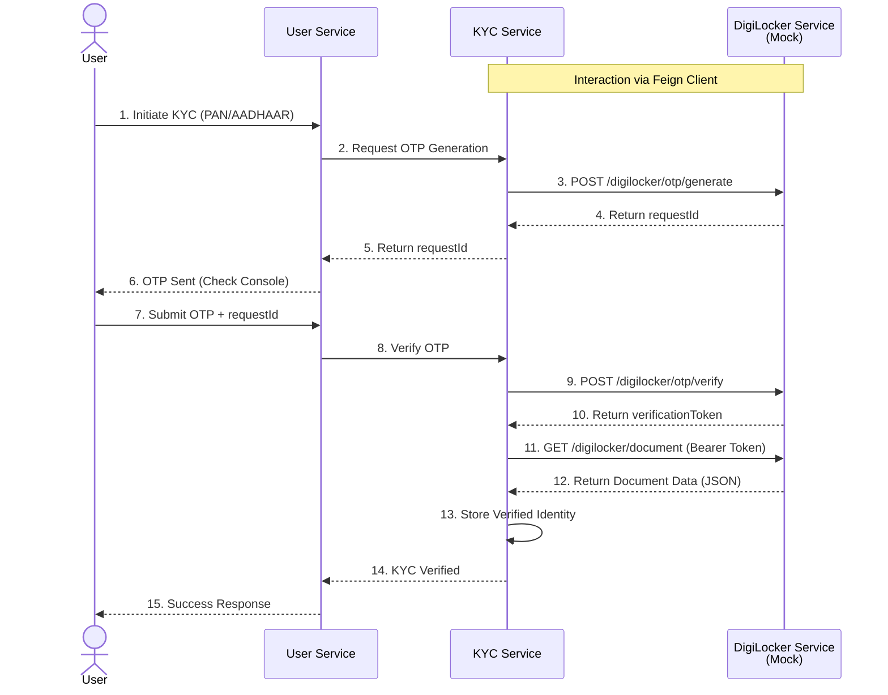

# DigiLocker Mock Service

A production-ready mock microservice that simulates Government KYC verification (UIDAI/NSDL) with an OTP-based flow and runtime dummy data generation.

## 🏗 Architecture Overview

- **Stack**: Spring Boot 3.5.10, Java 21
- **Architecture**: Controller → Service → Repository (In-Memory)
- **Features**:
    - OTP Generation & Validation
    - UUID-based Request & Token Management
    - Runtime Dummy Data Generation (Seed-based)
    - Simulated Latency/Failure (10% chance)
    - Global Exception Handling
    - OpenAPI/Swagger Documentation

## 🚀 API Endpoints

### 1. Generate OTP
- **URL**: `POST /digilocker/otp/generate`
- **Body**:
  ```json
  {
    "documentType": "PAN",
    "documentNumber": "ABCDE1234F"
  }
  ```
- **Response**: Returns `requestId`. OTP is logged in the console.

### 2. Verify OTP
- **URL**: `POST /digilocker/otp/verify`
- **Body**:
  ```json
  {
    "requestId": "uuid-from-step-1",
    "documentNumber": "ABCDE1234F",
    "otp": "123456" 
  }
  ```
  *(Note: Check application logs for the generated OTP)*
- **Response**: Returns `verificationToken` on success.

### 3. Fetch Verified Document
- **URL**: `GET /digilocker/document`
- **Headers**: `Authorization: Bearer <verificationToken>`
- **Query Params**: `documentType=PAN`, `documentNumber=ABCDE1234F`
- **Response**:
  ```json
  {
      "name": "User_123",
      "dob": "1995-05-15",
      "gender": "M",
      "address": "Generated Address 42",
      "documentNumber": "XXXX234F"
  }
  ```

### 4. Health Check
- **URL**: `GET /digilocker/health`
- **Response**: `{"status": "UP"}`

## 🧪 Testing

### Running Tests
To run the automated unit and integration tests:

```bash
mvn test
```

### Manual Testing (Postman)
1. **Start the Application**: `mvn spring-boot:run`
2. **Generate OTP**: Call `/digilocker/otp/generate`. Check console for OTP.
3. **Verify OTP**: Call `/digilocker/otp/verify` with the OTP.
4. **Get Data**: Call `/digilocker/document` with the token.

## 📦 Setup & Installation

1. **Prerequisites**: Java 21, Maven 3.8+
2. **Build**: `mvn clean install`
3. **Run**: `mvn spring-boot:run`
4. **Swagger UI**: Access http://localhost:8083/swagger-ui.html

## Service Discovery
This service registers with Eureka Server at `http://localhost:8761/eureka/`.

## 📊 Sequence Diagram: KYC Verification Flow

This diagram illustrates how the **KYC Service** orchestrates the verification process using the **DigiLocker Mock Service** via Feign Client.


