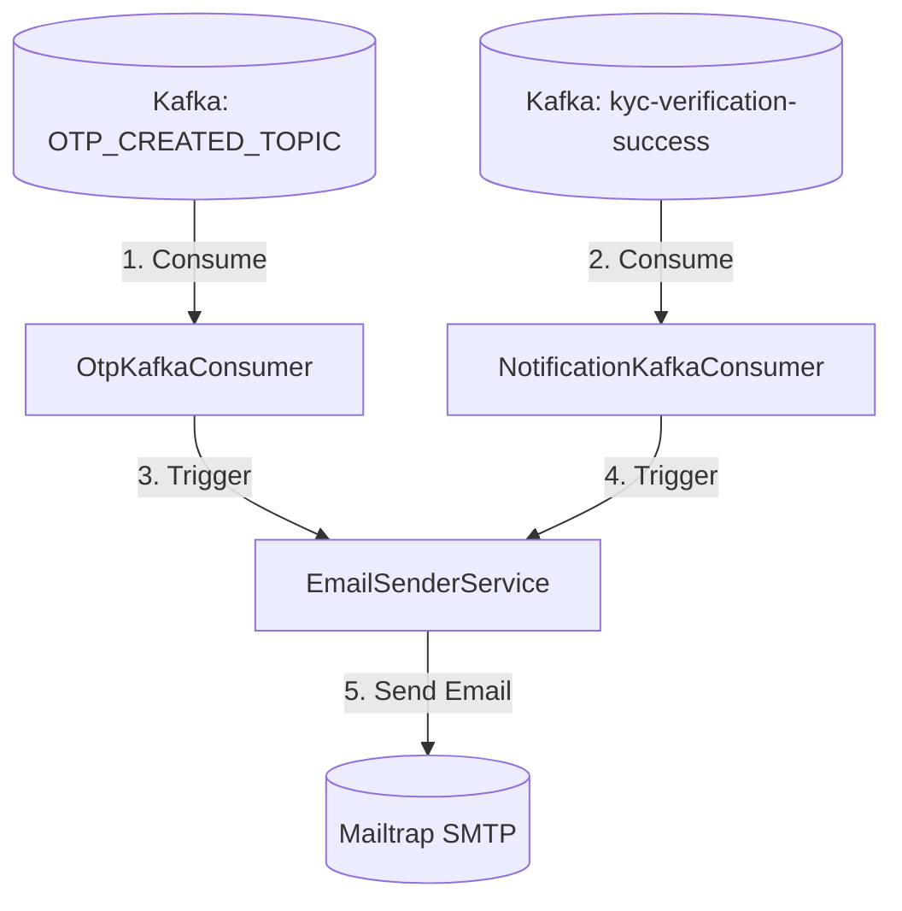
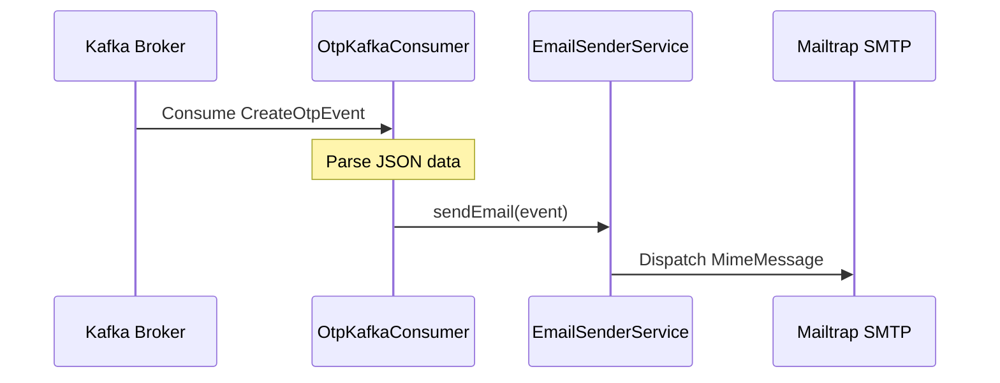

# 📧 Email Service

## 📌 Overview
The **Email Service** is a supporting microservice in the Centralized KYC System. Its primary responsibility is responding to Kafka events triggered by other services to dispatch confirmation or authentication details. Its primary responsibilities include:
*   **OTP Email Dispatch**: Listens to OTP generation events and sends verified items accurately.
*   **KYC Status Updates**: Listens to verification updates notifying endpoints seamlessly.

---

## 🛠️ Tech Stack
*   **Framework**: Spring Boot 4.x
*   **Email**: Spring Boot Starter Mail (Configured with Mailtrap SMTP)
*   **Messaging**: Apache Kafka (Consumer groups setup for `OTP_CREATED_TOPIC` & `kyc-verification-success`)
*   **Discovery**: Eureka Client registration

---

## 🏗️ System Architecture & Interactions

The Email Service acts as an Asynchronous Message Consumer triggering external SMTP pushes upon setup triggers.



---

## 🔄 Key Workflows

### 1️⃣ OTP Email Dispatch Flow
Message lifecycle consuming execution flow executed inside triggers.



---

## 🔌 API Endpoints (Kafka Consumers)

Since this is purely a consumer service, it does not expose REST APIs for triggers. It listens to the following topics:

| Topic | Event Payload | Consumer Group | Description |
| :--- | :--- | :--- | :--- |
| `OTP_CREATED_TOPIC` | `CreateOtpEvent` | `email-servic` | Consumes and sends OTP details email. |
| `kyc-verification-success` | `KycVerificationSuccessEvent` | `email-servic` | Consumes and sends KYC update status. |

---

## ⚙️ Configuration Hints
*   **SMTP Service**: Uses **Mailtrap** (`live.smtp.mailtrap.io`) configured inside `application.yml` targeting SMTP authentication.
*   **Kafka**: Utilizes consumer group `email-servic`.
*   **Threading**: Virtual threads enabled (`spring.threads.virtual.enabled=true`) for optimized setup.

---

## 🚀 Running the Service
1.  Ensure **DiscoveryService** (Port 8761) and **Kafka** are running.
2.  Run the application using Maven:
    ```bash
    mvn spring-boot:run
    ```
