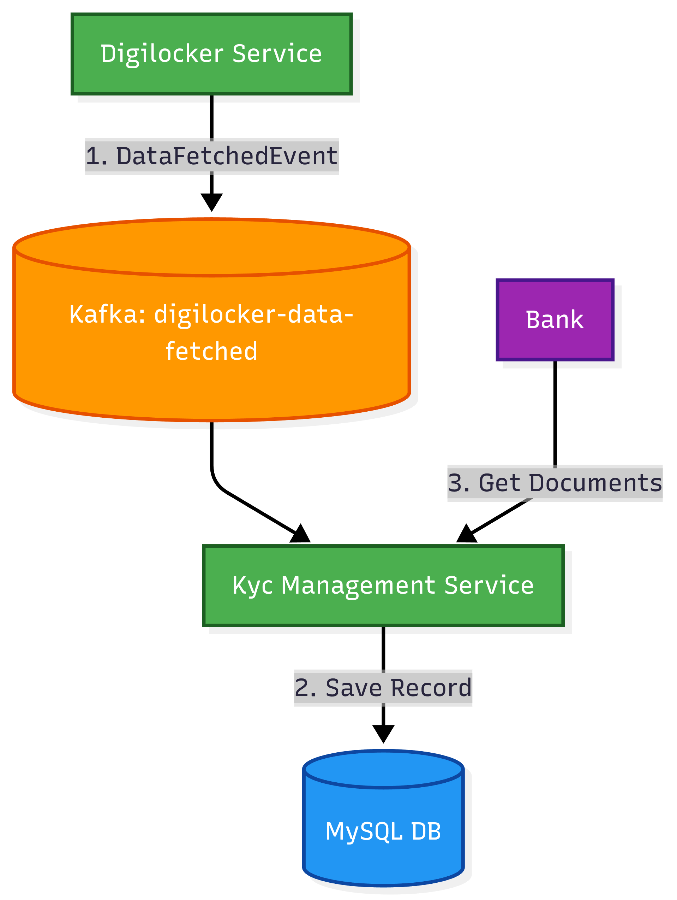
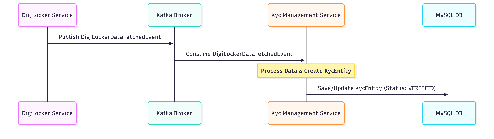

# 🛡️ KYC Management Service

## 📌 Overview
The **KYC Management Service** is a core microservice in the Centralized KYC System. It acts as the central orchestrator and repository for verified KYC data. Its primary responsibilities include:
*   **Centralized KYC Storage**: Consolidating user data securely mapping identity triggers.
*   **Data Aggregation**: Processing triggers from verification sources (like DigiLocker) to seed verified profiles.
*   **Authorization Interface**: Providing secure endpoints for Banks to fetch allowed user documents leveraging dynamic tokens.

---

## 🛠️ Tech Stack
*   **Framework**: Spring Boot 3.4.x
*   **Database**: MySQL (Relational persistence for detailed KYC structures)
*   **Caching**: Redis (For caching or session setups)
*   **Messaging**: Apache Kafka (Event-driven consumption of verified data streams)
*   **Client**: Spring Cloud OpenFeign, Eureka Client
*   **Security**: Spring Security + JWT

---

## 🏗️ System Architecture & Interactions

The Kyc Management Service interacts with async triggers consuming verified datasets to assemble structured records.




---

## 🔄 Key Workflows

### 1️⃣ KYC Data Sync Flow
Asynchronous updates consuming verified events triggers synchronisation lifecycles.




---

## 🔌 API Endpoints

All endpoints are prefixed with `/api/kyc` and routed via the **API Gateway (Port 8083)**.

| Method | Endpoint | Access Role | Description |
| :--- | :--- | :--- | :--- |
| **POST** | `/digilocker` | `Internal` | Stores verified Digilocker data triggers for a user. |
| **GET** | `/bank/documents` | `Bank` | Returns verified user data for a bank based on JWT details. |
| **GET** | `/{userId}` | `User` | Returns a summarized KYC profile dashboard context. |
| **GET** | `/{userId}/documents` | `User` | Returns a list of verified document proofs. |
| **GET** | `/{userId}/token` | `User` | Returns the current KYC token details. |
| **POST** | `/{userId}/token/revoke` | `User` | Revokes a user's access KYC token. |

---

## ⚙️ Configuration Hints
*   **Database**: Uses **MySQL** (`jdbc:mysql://localhost:3306/kyc`) for tracking structured datasets securely.
*   **Caching**: Uses **Redis** (Port 6379) for caching needs inside workflows.
*   **Kafka Topics**: Consumes `digilocker-data-fetched` payload streams mapping sources correctly.

---

## 🚀 Running the Service
1.  Ensure **DiscoveryService** (Port 8761) and **Kafka** are running.
2.  Ensure **MySQL** database `kyc` is active.
3.  Run the application using Maven:
    ```bash
    mvn spring-boot:run
    ```
