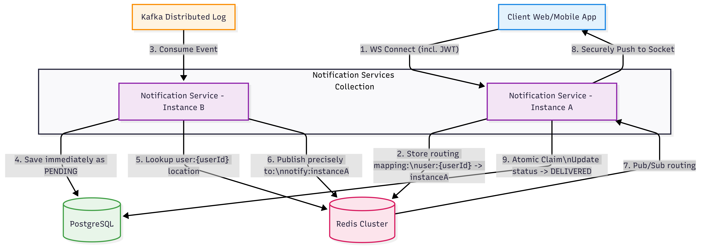
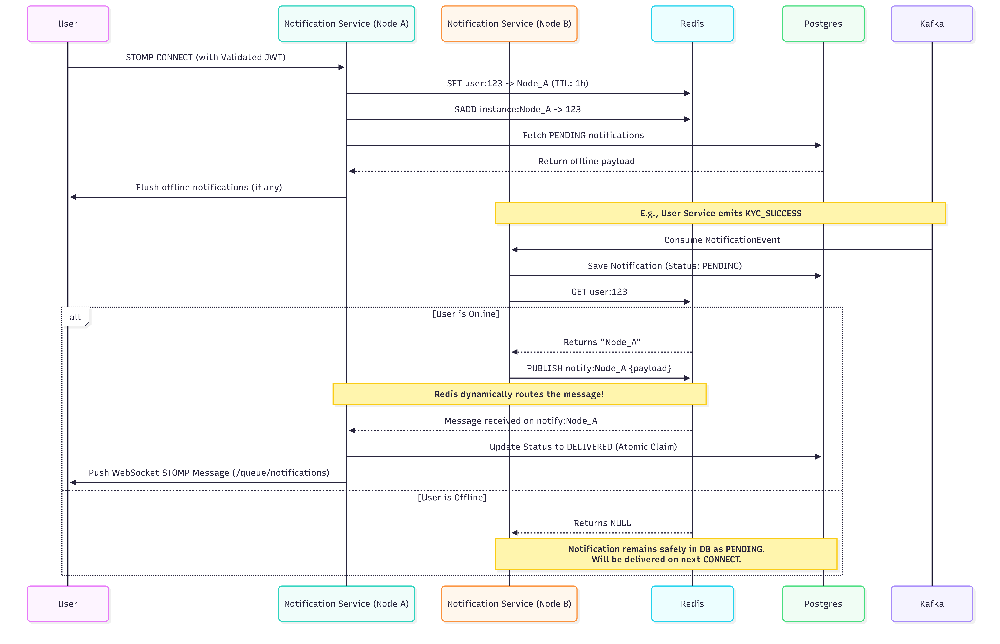
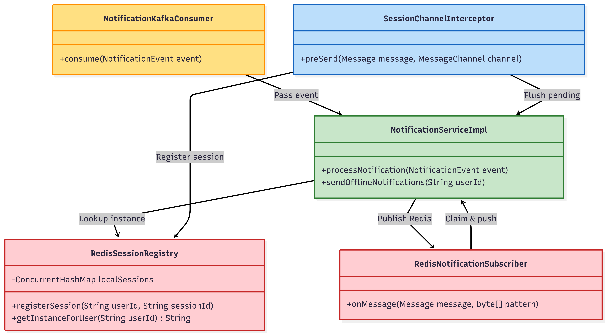

# Centralized KYC System - Notification Service

The Notification Service is a robust, highly-scalable, event-driven microservice responsible for delivering real-time notifications to users globally. It bridges asynchronous backend events (produced via **Apache Kafka**) with real-time frontend delivery (via **WebSockets**) while completely abstracting away the complexities of distributed node management using **Redis**.

---

## 🚀 Key Features and Code References

- **Fully Stateless Application Layer**: Connection mappings are externalized. 
  - 📄 *Reference:* [`RedisSessionRegistry.java`](src/main/java/rbi/notification/notification_systemds/service/impl/RedisSessionRegistry.java)
- **Dynamic Pub/Sub Routing**: Uses Redis to perform targeted message delivery, eliminating broadcast overhead.
  - 📄 *Reference:* [`RedisNotificationSubscriber.java`](src/main/java/rbi/notification/notification_systemds/redis/RedisNotificationSubscriber.java) and [`RedisConfig.java`](src/main/java/rbi/notification/notification_systemds/config/RedisConfig.java)
- **Reliability & Idempotency**: Leverages Kafka `@RetryableTopic` for automated Dead Letter Queue (DLQ) support and database constraints for exact-once event processing.
  - 📄 *Reference:* [`NotificationKafkaConsumer.java`](src/main/java/rbi/notification/notification_systemds/kafka/NotificationKafkaConsumer.java)
- **Guaranteed Offline Delivery**: Catches PENDING notifications when a user is disconnected and instantly flushes them to the client upon their next `STOMP CONNECT`.
  - 📄 *Reference:* [`SessionChannelInterceptor.java`](src/main/java/rbi/notification/notification_systemds/interceptor/SessionChannelInterceptor.java) and [`NotificationServiceImpl.java`](src/main/java/rbi/notification/notification_systemds/service/impl/NotificationServiceImpl.java)
- **Zero-Configuration Observability**: Fully instrumented with Spring Boot Actuator and Micrometer for native Prometheus/Grafana metric scraping.
  - 📄 *Reference:* [`pom.xml`](pom.xml)

---

## 🏗️ System Architecture Diagram

This architecture highlights how the system operates in a clustered, multi-instance environment without retaining local state (beyond the active physical WebSocket connection).



---

## 🔄 Interaction Sequence Diagram

The following sequence details exactly how an event emitted by another microservice seamlessly makes its way across the backend topology, identifies the node holding the user, and delivers the payload instantly.



---

## 🧩 Core Class Structure Diagram

The internal Java components interact precisely to decouple Kafka ingestion from WebSocket dispatching natively within Spring Boot.



---

## 🛠️ Tech Stack & Requirements

- **Java 21 / Spring Boot 3.5.x**
- **Spring WebSocket / STOMP**
- **Spring Kafka & `@RetryableTopic`**
- **Spring Data Redis / PubSub**
- **Spring Data JPA / Hibernate Core**

### Quick Start
To run the service locally:

1. Ensure **Redis**, **Kafka (or Zookeeper)**, and **MySQL/Postgres** are running locally.
2. Compile and start via Maven Wrapper:
   ```bash
   ./mvnw spring-boot:run
   ```
3. Endpoint configuration:
   - WebSocket URL: `ws://localhost:8085/ws`
   - Broker Topic: `/queue/notifications`

### Local Logging & Metrics
- Standard STOMP endpoints mapped onto Spring Interceptors.
- Check Prometheus scraped outcomes safely integrated at `/actuator/prometheus`.
