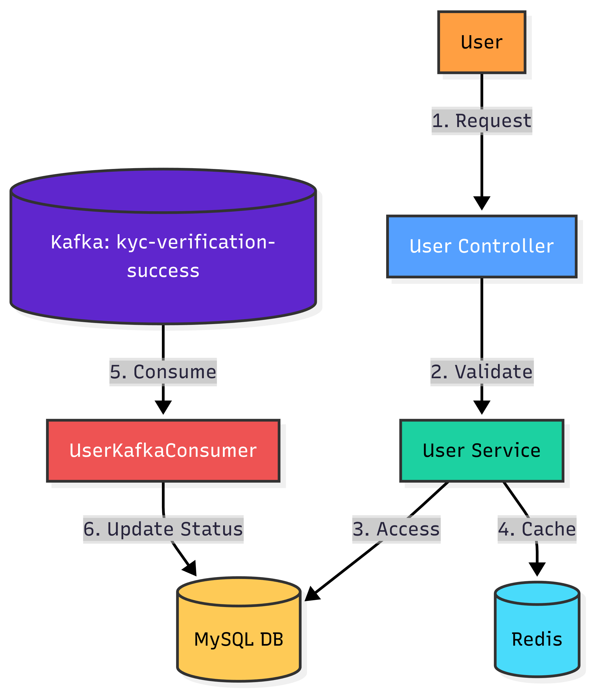
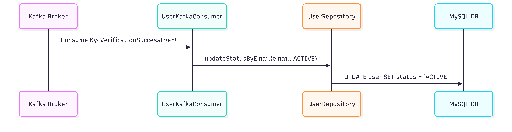

# 👥 User Service

## 📌 Overview
The **User Service** is a core microservice in the Centralized KYC System. It manages user profiles, authentication, and core registration lifecycles. Its primary responsibilities include:
*   **User Management**: Registering new users and maintaining account profiles.
*   **Authentication**: Supporting OTP-based login workflows and issuing session JWTs.
*   **KYC Status Management**: Listening to verification updates back downstream maintaining accurate dashboards.

---

## 🛠️ Tech Stack
*   **Framework**: Spring Boot 3.5.x
*   **Database**: MySQL (Relational persistence for detailed user items)
*   **Caching**: Redis (For OTP caching and security sessions)
*   **Messaging**: Apache Kafka (Consuming KYC status success triggers)
*   **Discovery**: Eureka Client registration
*   **Security**: Spring Security + JWT

---

## 🏗️ System Architecture & Interactions

The User Service handles synchronous API requests and consumes asynchronous status triggers updating the database efficiently.




---

## 🔄 Key Workflows

### 1️⃣ KYC Status Update Flow
Asynchronous lifecycles consumed triggers promoting user profiles securely.




---

## 🔌 API Endpoints

All endpoints are prefixed with `/user` and routed via the **API Gateway (Port 8083)**.

| Method | Endpoint | Access Role | Description |
| :--- | :--- | :--- | :--- |
| **POST** | `/register` | `Public` | Registers a new user with basic profile details. |
| **POST** | `/otp/request` | `Public` | Sends an OTP to the user's email if they exist. |
| **POST** | `/otp/verify` | `Public` | Verifies the OTP and returns a login JWT token. |
| **POST** | `/logout` | `User` | Logs out a user by invalidating their token setup. |
| **GET** | `/details` | `User` | Fetches user profile details by email query. |
| **GET** | `/kyc-status/{email}` | `User` | Returns the absolute KYC status for a user. |

---

## ⚙️ Configuration Hints
*   **Database**: Uses **MySQL** (`jdbc:mysql://localhost:3306/kyc`) for user records securely.
*   **Caching**: Uses **Redis** (Port 6379) for 6-digit OTP verification caches.
*   **Kafka**: Consumes topic `kyc-verification-success` using group `user-service-group`.

---

## 🚀 Running the Service
1.  Ensure **DiscoveryService** (Port 8761) and **Kafka** are running.
2.  Ensure **MySQL** database `kyc` and **Redis** are active.
3.  Run the application using Maven:
    ```bash
    mvn spring-boot:run
    ```
