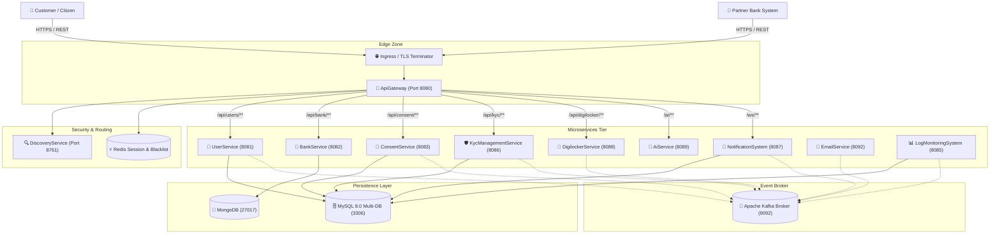

# Centralized KYC System — Production Hardened Platform

[](https://github.com/shrihari7396/Centralized-KYC-System-Backend/actions/workflows/maven.yml)
[](https://opensource.org/licenses/Apache-2.0)
[](https://spring.io/projects/spring-boot)
[](https://adoptium.net/)

The **Centralized KYC (Know Your Customer) Platform** is a distributed, high-security financial identity verification system designed to provide a single, reusable, cryptographically verified KYC token across authorized banking institutions. The platform shifts financial institutions away from repetitive document handling toward tokenized, user-consented attribute sharing.

---

## 🏛️ System Architecture



---

## 📋 Microservices Roster

| Service | Port | Database | Primary Purpose | Hardening Status |
| :--- | :--- | :--- | :--- | :--- |
| **[DiscoveryService](file:///c:/Users/shrih/Desktop/Temp/Centralized-KYC-System-Backend/Backend/DiscoveryService)** | `8761` | In-Memory | Netflix Eureka Service Registry | ✅ Hardened |
| **[ApiGateway](file:///c:/Users/shrih/Desktop/Temp/Centralized-KYC-System-Backend/Backend/ApiGateway)** | `8080` | Redis | Edge Router, JWT Validation, Rate Limiting | ✅ Hardened |
| **[UserService](file:///c:/Users/shrih/Desktop/Temp/Centralized-KYC-System-Backend/Backend/UserService)** | `8081` | MySQL (`users`) | Identity lifecycle, 3-attempt OTP lockout, AES-256-GCM | ✅ Hardened |
| **[BankService](file:///c:/Users/shrih/Desktop/Temp/Centralized-KYC-System-Backend/Backend/BankService)** | `8082` | MongoDB (`kyc_db`) | Bank customer KYC onboarding, Admin bypass | ✅ Hardened |
| **[ConsentService](file:///c:/Users/shrih/Desktop/Temp/Centralized-KYC-System-Backend/Backend/ConsentService)** | `8083` | MySQL (`kyc_consent_db`) | Granular, time-bound customer consent authority | ✅ Hardened |
| **[LogMonitoringSystem](file:///c:/Users/shrih/Desktop/Temp/Centralized-KYC-System-Backend/Backend/LogMonitoringSystem)** | `8085` | MySQL (`kyc`) | Immutable audit logs, threat assessment engine | ✅ Hardened |
| **[KycManagementService](file:///c:/Users/shrih/Desktop/Temp/Centralized-KYC-System-Backend/Backend/KycManagementService)** | `8086` | MySQL (`kyc`) | Core KYC authority, JJWT token verification, masking | ✅ Hardened |
| **[NotificationSystem](file:///c:/Users/shrih/Desktop/Temp/Centralized-KYC-System-Backend/Backend/NotificationSystem)** | `8087` | MySQL (`kyc_notification_db`) | STOMP WebSocket push routing across multi-instance nodes | ✅ Hardened |
| **[DigilockerService](file:///c:/Users/shrih/Desktop/Temp/Centralized-KYC-System-Backend/Backend/DigilockerService)** | `8088` | Redis | Verified document claim simulation, OTP lockout | ✅ Hardened |
| **[AiService](file:///c:/Users/shrih/Desktop/Temp/Centralized-KYC-System-Backend/Backend/AiService)** | `8089` | N/A | AI compliance assistant with RestTemplate timeouts | ✅ Hardened |
| **[EmailService](file:///c:/Users/shrih/Desktop/Temp/Centralized-KYC-System-Backend/Backend/EmailService)** | `8092` | N/A | Multi-template transactional email dispatcher | ✅ Hardened |

---

## 🔒 Production Hardening & Compliance Improvements

1. **Complete Secret Sanitization**:
   - Zero hardcoded passwords or JWT secrets in source code, properties, or manifests.
   - Dynamic injection via `${JWT_SECRET}`, `${MYSQL_PASSWORD}`, `${ENCRYPTION_SECRET_KEY}`.
   - Secure templates provided in [`.env.example`](file:///c:/Users/shrih/Desktop/Temp/Centralized-KYC-System-Backend/.env.example) and [`deploy/k8s/02-secrets.example.yaml`](file:///c:/Users/shrih/Desktop/Temp/Centralized-KYC-System-Backend/deploy/k8s/02-secrets.example.yaml).

2. **Zero-Trust Security & Access Control**:
   - Eliminated unauthenticated request bypass in [ApiGateway/JwtFilter.java](file:///c:/Users/shrih/Desktop/Temp/Centralized-KYC-System-Backend/Backend/ApiGateway/src/main/java/com/rbi/apigateway/filters/JwtFilter.java).
   - Removed privilege escalation vulnerability in `UserServiceImpl.java`; user roles derived exclusively from persistent records.
   - Replaced naive Base64 parsing with cryptographic JJWT verification in [KycManagementService/JwtParserUtil.java](file:///c:/Users/shrih/Desktop/Temp/Centralized-KYC-System-Backend/Backend/KycManagementService/src/main/java/org/rbi/kycmanagementservice/service/JwtParserUtil.java).
   - Added `@PreAuthorize("hasRole('ADMIN')")` on bank bypass endpoints.

3. **PII Data Protection & AES-256-GCM**:
   - Enabled transparent column-level encryption for Aadhaar, PAN, phone numbers, and full names in MySQL.
   - Purged all plaintext OTPs and PII from application logs and console stdout across all services.

4. **Brute-Force & Lockout Safeguards**:
   - OTP validity reduced from 10 minutes to standard 3 minutes.
   - Enforced 3-attempt failure lockout (15-minute temporary lock) via Redis keys across User, Bank, Consent, and DigiLocker services.

5. **Schema Control with Flyway**:
   - Replaced uncontrolled `ddl-auto: update` with Flyway migrations (`V1__initial_schema.sql`) across all relational services.
   - Added `init.sql` for automated database provisioning in local and CI environments.

6. **Container & Kubernetes Hardening**:
   - All Docker images run as unprivileged `appuser:appgroup` (UID `10001:10001`).
   - Container JVM limits configured (`-XX:+UseContainerSupport -XX:MaxRAMPercentage=75.0`).
   - Added TLS Ingress, NetworkPolicies, HorizontalPodAutoscalers (HPA), and PodDisruptionBudgets (PDB).

---

## 🚀 Getting Started

### Prerequisites
* **Java 21 LTS** (Eclipse Temurin recommended)
* **Maven 3.9+**
* **Docker & Docker Compose**

### 1. Configure Environment Secrets
Create a `.env` file from the provided template:
```bash
cp .env.example .env
```

### 2. Start Infrastructure Services
Start MySQL, MongoDB, Redis, and Kafka using Docker Compose:
```bash
docker compose -f Backend/docker-compose.yml up -d mysql mongodb redis kafka
```

### 3. Build All Microservices
From the repository root, compile and run the comprehensive test suite:
```bash
mvn clean test
```

### 4. Run Locally
Start the services in dependency order:
```bash
# 1. Start Discovery Service
mvn -pl Backend/DiscoveryService spring-boot:run

# 2. Start API Gateway
mvn -pl Backend/ApiGateway spring-boot:run

# 3. Start Core Services
mvn -pl Backend/UserService spring-boot:run
mvn -pl Backend/KycManagementService spring-boot:run
mvn -pl Backend/ConsentService spring-boot:run
mvn -pl Backend/BankService spring-boot:run
```

---

## ☸️ Kubernetes Deployment

Deploy the complete platform using Kustomize:
```bash
# 1. Create Secrets from Example
kubectl apply -f deploy/k8s/00-namespace.yaml
kubectl apply -f deploy/k8s/02-secrets.yaml

# 2. Deploy Full Infrastructure and Microservices
kubectl apply -k deploy/k8s/

# 3. Verify Pod Health
kubectl get pods -n kyc-system -w
```

---

## 📚 Technical Documentation & Runbooks

* 📑 **Forensic Security Audit:** [docs/production-audit.md](file:///c:/Users/shrih/Desktop/Temp/Centralized-KYC-System-Backend/docs/production-audit.md)
* 🛡️ **Trust Boundaries & Zero-Trust Architecture:** [docs/architecture/trust-boundaries.md](file:///c:/Users/shrih/Desktop/Temp/Centralized-KYC-System-Backend/docs/architecture/trust-boundaries.md)
* 🛠️ **Production Deployment Checklist:** [docs/runbooks/production-checklist.md](file:///c:/Users/shrih/Desktop/Temp/Centralized-KYC-System-Backend/docs/runbooks/production-checklist.md)
* 🗺️ **Production Engineering Roadmap:** [docs/production-roadmap.md](file:///c:/Users/shrih/Desktop/Temp/Centralized-KYC-System-Backend/docs/production-roadmap.md)
* 🚨 **RFC 7807 API Error Contract:** [docs/api-error-contract.md](file:///c:/Users/shrih/Desktop/Temp/Centralized-KYC-System-Backend/docs/api-error-contract.md)

---

## 📄 License
This project is licensed under the Apache License 2.0 - see the [LICENSE](file:///c:/Users/shrih/Desktop/Temp/Centralized-KYC-System-Backend/LICENSE) file for details.
