# Centralized KYC System

## 📌 Project Overview

The **Centralized KYC (Know Your Customer) System** is a secure and scalable platform designed to simplify and standardize the KYC verification process across multiple organizations. Instead of repeating KYC for every service, this system maintains a single verified KYC record for each user, which can be securely accessed by authorized institutions.

The project focuses on **data security, reusability, and efficiency**, reducing verification time, operational cost, and data duplication while ensuring compliance with regulatory standards.

---

## 🎯 Objectives

* Eliminate repeated KYC processes across organizations
* Provide a single source of verified customer data
* Ensure secure storage and controlled data access
* Improve verification speed and user experience

---

## 🧩 Key Features

* Centralized storage of customer KYC data
* Secure user registration and authentication
* Document upload and verification workflow
* Role-based access for institutions and admins
* KYC status tracking (Pending / Verified / Rejected)
* Data privacy and encryption support by database level encryption 
* Automated Lifecycle Management (Periodic Updation): Implementing workflows for real-time KYC revocation, renewal, and address updation
---

## 🛠️ Technology Stack

**Backend:** Java, Spring Boot
**Frontend:** React.js (or HTML/CSS/JS)
**Database:** MySQL
**Security:** JWT Authentication, Role-Based Access Control
**Tools:** Maven, Git, REST APIs

---

## 📂 Microservices Architecture

The system is built using a **Cloud-Native Microservices Architecture** with independent, domain-driven services communicating via REST APIs and Apache Kafka event streams.

| Service | Technology | Port | Database | Description | README |
| :--- | :--- | :--- | :--- | :--- | :--- |
| 🚪 **API Gateway** | Spring Cloud Gateway | 8083 | - | Single entry point routing requests, handling rate limiting and authentication. | [README](Backend/ApiGateway/README.md) |
| 🔍 **Discovery Service** | Netflix Eureka | 8761 | - | Dynamic service registry and health monitoring. | [README](Backend/DiscoveryService/README.md) |
| 👥 **User Service** | Spring Boot | 8090 | MySQL (`users`) | Manages user registration, authentication (OTP/JWT), and lifecycle statuses. | [README](Backend/UserService/README.md) |
| 🛡️ **KYC Management** | Spring Boot | 8086 | MySQL (`kyc`) | Core orchestrator aggregating verified identity streams into structured KYC records. | [README](Backend/KycManagementService/README.md) |
| 📝 **Consent Service** | Spring Boot | 8084 | MySQL (`kyc_consent_db`) | Governs customer consent lifecycles for secure, time-bounded data sharing with banks. | [README](Backend/ConsentService/README.md) |
| 🏦 **Bank Service** | Spring Boot | 8091 | MongoDB (`kyc_db`) | Banking portal for managing customer onboarding, KYC consent requests, and document intake. | [README](Backend/BankService/README.md) |
| 🛡️ **Digilocker Service** | Spring Boot | 8088 | - | Integration service for fetching and validating government DigiLocker identity proofs. | [README](Backend/DigilockerService/README.md) |
| 📧 **Email Service** | Spring Boot | 8092 | - | Asynchronous service dispatching transactional notifications and OTP emails. | [README](Backend/EmailService/README.md) |
| 🔔 **Notification System** | Spring Boot | 8087 | MySQL (`kyc_notification_db`) | Manages multi-channel notification records and delivery statuses. | [README](Backend/NotificationSystem/README.md) |
| 📊 **Log Monitoring (SentientGate)** | Spring Boot | 8085 | MySQL (`kyc`) | High-throughput runtime security monitoring, traffic profiling, and threat assessment. | [README](Backend/LogMonitoringSystem/README.md) |
| 🧠 **AI Service** | Spring Boot | 8089 | - | AI-assisted automated document verification and fraud detection. | [README](Backend/AiService/README.md) |

---

## 🗄️ Database Architecture & Entity Relationship Diagram

The backend employs a **polyglot persistence** model combining MySQL for relational consistency and MongoDB for flexible document storage.

### Complete System ER Diagram (Mermaid)

```mermaid
erDiagram
    USERS {
        string id PK "UUID (length 36)"
        string email UK "Unique email address"
        string first_name "Encrypted/Plain text"
        string last_name "Encrypted/Plain text"
        string phone UK "Unique phone number"
        string roles "Enum: USER"
        string status "Enum: KYC_PENDING, KYC_REJECTED, ACTIVE"
        datetime last_login_at "Last login timestamp"
        datetime created_at "Creation timestamp"
        datetime updated_at "Update timestamp"
    }

    KYC_RECORDS {
        uuid kyc_id PK "UUID"
        string user_id FK "References USERS.id"
        string mobile_number "Contact phone number"
        string aadhar_number "Aadhaar number"
        string pan_number "PAN number"
        string first_name "First name"
        string last_name "Last name"
        string middle_name "Middle name"
        string email "Email address"
        date dob "Date of birth"
        text address "Residential address"
        string verification_status "Verification status"
        datetime created_at "Creation timestamp"
        datetime updated_at "Update timestamp"
    }

    KYC_ENTITIES {
        string user_id PK "References USERS.id"
        text aadhaar_no "AES-256 encrypted"
        text pan "AES-256 encrypted"
        text driving_license "AES-256 encrypted"
        string street "Embedded Address.street"
        string city "Embedded Address.city"
        string state "Embedded Address.state"
        string zip_code "Embedded Address.zipCode"
        string country "Embedded Address.country"
        string status "Status string"
    }

    CONSENT_RECORDS {
        string id PK "Length 64"
        string user_id FK "References USERS.id"
        string bank_id FK "References BANKS.id"
        string consent_status "Enum: PENDING, APPROVED, REJECTED, EXPIRED"
        datetime requested_at "Timestamp of request"
        datetime approved_at "Timestamp of approval"
        datetime expiry_at "Timestamp of expiration"
        boolean active "Active status flag"
        text consent_documents "Serialized list of requested documents"
    }

    BANKS {
        string id PK "MongoDB _id"
        string name "Bank full name"
        string code UK "Unique bank code"
        string username UK "Portal login username"
        datetime created_at "Registration timestamp"
    }

    BANK_CUSTOMERS {
        string id PK "MongoDB _id"
        string user_id FK "References USERS.id"
        string bank_id FK "References BANKS.id"
        list consent_ids "Array of Consent IDs"
        long kyc_request_id "KYC request tracking ID"
        string risk_level "LOW, MEDIUM, HIGH"
        string override_reason "Manual status override reason"
        datetime verified_at "Verification timestamp"
        datetime created_at "Record creation timestamp"
    }

    BANK_CONSENTS {
        string id PK "MongoDB _id"
        string consent_id FK "References CONSENT_RECORDS.id"
        string bank_id FK "References BANKS.id"
        string user_id FK "References USERS.id"
        string status "Enum: CONSENT_PENDING, KYC_PENDING, ACTIVE, KYC_REJECTED, ACTIVE_OVERRIDE"
        list requested_documents "List: AADHAAR, PAN, DRIVING_LICENSE, etc."
        datetime created_at "Creation timestamp"
        datetime updated_at "Update timestamp"
    }

    BANK_CUSTOMER_KYC_DATA {
        string id PK "MongoDB _id"
        string user_id FK "References USERS.id"
        string bank_id FK "References BANKS.id"
        string consent_id FK "References CONSENT_RECORDS.id"
        json kyc_data "Arbitrary decrypted KYC payload"
        datetime created_at "Ingestion timestamp"
    }

    NOTIFICATIONS {
        string id PK "UUID length 36"
        string target_id "User or Entity ID"
        string email "Recipient email"
        text message "Notification text payload"
        string type "Notification category/channel"
        string status "Enum: PENDING, SENT, DELIVERED"
        datetime created_at "Creation timestamp"
    }

    LOGS {
        uuid id PK "UUID"
        string service_id "Originating microservice"
        string event_type "Event classification"
        int level "Enum: 0=INFO, 1=WARNING, 2=ERROR"
        timestamp occurred_at "Event creation timestamp"
        text payload "JSON payload"
        timestamp ingested_at "Kafka ingestion timestamp"
    }

    TRAFFIC_PROFILES {
        string key PK "Composite key: ip:endpoint"
        string ip "Client IP"
        string endpoint "Target API route"
        long request_count "Total requests in window"
        long error_count "Total errors in window"
        double avg_payload_size "Average payload size (bytes)"
        double payload_entropy "Anomaly entropy metric"
        double avg_inter_request_gap "Mean gap between requests"
        timestamp window_start "Profile window start"
        timestamp window_end "Profile window end"
    }

    THREAT_ASSESSMENTS {
        uuid id PK "UUID"
        string source_key FK "References TRAFFIC_PROFILES.key"
        double threat_score "Calculated threat score (0.0 - 1.0)"
        string classification "NORMAL, SUSPICIOUS, ATTACK"
        string decision "RATE_LIMIT, BLOCK, ALLOW"
        timestamp evaluated_at "Assessment timestamp"
    }

    USERS ||--o{ KYC_RECORDS : "has"
    USERS ||--o| KYC_ENTITIES : "owns"
    USERS ||--o{ CONSENT_RECORDS : "grants"
    USERS ||--o{ BANK_CUSTOMERS : "associates"
    USERS ||--o{ BANK_CONSENTS : "grants"
    USERS ||--o{ BANK_CUSTOMER_KYC_DATA : "stores_data_for"
    USERS ||--o{ NOTIFICATIONS : "receives"

    BANKS ||--o{ CONSENT_RECORDS : "receives_consent_from"
    BANKS ||--o{ BANK_CUSTOMERS : "manages"
    BANKS ||--o{ BANK_CONSENTS : "tracks"
    BANKS ||--o{ BANK_CUSTOMER_KYC_DATA : "retains"

    CONSENT_RECORDS ||--o| BANK_CONSENTS : "mirrors"
    CONSENT_RECORDS ||--o| BANK_CUSTOMER_KYC_DATA : "authorizes"

    TRAFFIC_PROFILES ||--o{ THREAT_ASSESSMENTS : "triggers"
```

---

## 📋 Comprehensive Database Schema Reference

### 1. User Service
* **Database:** MySQL (`users` / `kyc`)
* **Entity:** `UserEntity.java`
* **Table:** `users`

| Column Name | Data Type | Nullable | Constraints | Description |
| :--- | :--- | :--- | :--- | :--- |
| `id` | `VARCHAR(36)` | NO | PRIMARY KEY | Unique UUID generated on user registration |
| `email` | `VARCHAR(255)` | NO | UNIQUE | User primary email address |
| `first_name` | `TEXT` | NO | - | First name |
| `last_name` | `TEXT` | NO | - | Last name |
| `phone` | `TEXT` | NO | UNIQUE | Contact phone number |
| `roles` | `VARCHAR(20)` | YES | Default: `USER` | Role enum (`USER`) |
| `status` | `VARCHAR(20)` | NO | Enum: `UserStatus` | Lifecycle status (`KYC_PENDING`, `KYC_REJECTED`, `ACTIVE`) |
| `last_login_at` | `DATETIME` | YES | - | Last successful authentication timestamp |
| `created_at` | `DATETIME` | YES | `@CreationTimestamp` | Account creation timestamp |
| `updated_at` | `DATETIME` | YES | `@UpdateTimestamp` | Last profile update timestamp |

---

### 2. KYC Management Service
* **Database:** MySQL (`kyc`)

#### A. Table: `kyc_records`
* **Entity:** `KycRecord.java`
* **Purpose:** Stores comprehensive KYC demographic details received from verified data pipelines.

| Column Name | Data Type | Nullable | Constraints | Description |
| :--- | :--- | :--- | :--- | :--- |
| `kyc_id` | `BINARY(16)` / `UUID` | NO | PRIMARY KEY | Unique KYC record UUID |
| `user_id` | `VARCHAR(255)` | YES | FK (`users.id`) | Foreign reference to user identifier |
| `mobile_number` | `VARCHAR(255)` | YES | - | Contact phone number |
| `aadhar_number` | `VARCHAR(255)` | YES | - | Aadhaar identification number |
| `pan_number` | `VARCHAR(255)` | YES | - | Permanent Account Number (PAN) |
| `first_name` | `VARCHAR(255)` | YES | - | Verified first name |
| `last_name` | `VARCHAR(255)` | YES | - | Verified last name |
| `middle_name` | `VARCHAR(255)` | YES | - | Verified middle name |
| `email` | `VARCHAR(255)` | YES | - | Verified email address |
| `dob` | `DATE` | YES | - | Date of birth |
| `address` | `TEXT` | YES | - | Residential street address |
| `verification_status` | `VARCHAR(255)` | YES | - | Verification status string |
| `created_at` | `DATETIME` | YES | - | Record creation timestamp |
| `updated_at` | `DATETIME` | YES | - | Record modification timestamp |

#### B. Table: `kyc_entities`
* **Entity:** `KycEntity.java`
* **Purpose:** Stores encrypted identity document numbers with embedded address structure.

| Column Name | Data Type | Nullable | Constraints | Description |
| :--- | :--- | :--- | :--- | :--- |
| `user_id` | `VARCHAR(255)` | NO | PRIMARY KEY | Foreign reference to `users.id` |
| `aadhaar_no` | `TEXT` | YES | AES-256 Encrypted | Encrypted Aadhaar number (`StringCryptoConverter`) |
| `pan` | `TEXT` | YES | AES-256 Encrypted | Encrypted PAN number (`StringCryptoConverter`) |
| `driving_license` | `TEXT` | YES | AES-256 Encrypted | Encrypted Driving License (`StringCryptoConverter`) |
| `street` | `VARCHAR(255)` | YES | Embedded (`Address`) | Street address |
| `city` | `VARCHAR(255)` | YES | Embedded (`Address`) | City |
| `state` | `VARCHAR(255)` | YES | Embedded (`Address`) | State / Province |
| `zip_code` | `VARCHAR(255)` | YES | Embedded (`Address`) | Postal / Zip code |
| `country` | `VARCHAR(255)` | YES | Embedded (`Address`) | Country |
| `status` | `VARCHAR(255)` | YES | - | Entity processing status |

---

### 3. Consent Service
* **Database:** MySQL (`kyc_consent_db`)
* **Entity:** `ConsentRecord.java`
* **Table:** `consents`
* **Indexes:** `idx_user_bank` on `(user_id, bank_id)`

| Column Name | Data Type | Nullable | Constraints | Description |
| :--- | :--- | :--- | :--- | :--- |
| `id` | `VARCHAR(64)` | NO | PRIMARY KEY | Unique Consent Identifier |
| `user_id` | `VARCHAR(100)` | NO | Index (`idx_user_bank`) | Reference to `users.id` |
| `bank_id` | `VARCHAR(255)` | NO | Index (`idx_user_bank`) | Reference to `banks.id` |
| `consent_status` | `VARCHAR(20)` | NO | Enum: `ConsentStatus` | `PENDING`, `APPROVED`, `REJECTED`, `EXPIRED` |
| `requested_at` | `DATETIME` | YES | - | Consent request generation timestamp |
| `approved_at` | `DATETIME` | YES | - | Customer approval timestamp |
| `expiry_at` | `DATETIME` | YES | - | Expiration timestamp |
| `active` | `BOOLEAN` | NO | - | Consent validity status flag |
| `consent_documents` | `TEXT` | YES | - | JSON serialized list of requested documents |

---

### 4. Bank Service
* **Database:** MongoDB (`kyc_db`)

#### A. Collection: `banks`
* **Document:** `Bank.java`

| Field Name | Type | Key / Constraint | Description |
| :--- | :--- | :--- | :--- |
| `_id` | `String` | PRIMARY KEY | Unique bank identifier |
| `name` | `String` | - | Full name of the financial institution |
| `code` | `String` | UNIQUE | Unique bank identification code (e.g. `HDFC001`) |
| `username` | `String` | UNIQUE | Bank portal login username |
| `createdAt` | `LocalDateTime` | - | Registration timestamp |

#### B. Collection: `bank_customers`
* **Document:** `BankCustomer.java`

| Field Name | Type | Key / Constraint | Description |
| :--- | :--- | :--- | :--- |
| `_id` | `String` | PRIMARY KEY | Unique relationship record ID |
| `userId` | `String` | INDEX | Associated user ID (`users.id`) |
| `bankId` | `String` | INDEX | Associated bank ID (`banks.id`) |
| `consentIds` | `List<String>` | - | Array of associated Consent IDs |
| `kycRequestId` | `Long` | - | Internal KYC request tracking ID |
| `riskLevel` | `String` | - | Risk category: `LOW`, `MEDIUM`, `HIGH` |
| `overrideReason` | `String` | - | Audit justification for manual status override |
| `verifiedAt` | `LocalDateTime` | - | Timestamp when verification was completed |
| `createdAt` | `LocalDateTime` | - | Record creation timestamp |

#### C. Collection: `consents`
* **Document:** `Consent.java`

| Field Name | Type | Key / Constraint | Description |
| :--- | :--- | :--- | :--- |
| `_id` | `String` | PRIMARY KEY | Document ID |
| `consentId` | `String` | INDEX | Reference to `ConsentRecord.id` in ConsentService |
| `bankId` | `String` | INDEX | Target bank ID |
| `userId` | `String` | INDEX | Target user ID |
| `status` | `String` / Enum | `KycStatus` | `CONSENT_PENDING`, `KYC_PENDING`, `ACTIVE`, `KYC_REJECTED`, `ACTIVE_OVERRIDE` |
| `requestedDocuments` | `List<DocumentType>` | - | List of requested document types (`AADHAAR`, `PAN`, `DRIVING_LICENSE`, `BANK_STATEMENT`, `ADDRESS_PROOF`, `INCOME_PROOF`, `PHOTO`) |
| `createdAt` | `LocalDateTime` | - | Timestamp when consent was initiated |
| `updatedAt` | `LocalDateTime` | - | Timestamp when status was updated |

#### D. Collection: `bank_customer_kyc_data`
* **Document:** `BankCustomerKycData.java`

| Field Name | Type | Key / Constraint | Description |
| :--- | :--- | :--- | :--- |
| `_id` | `String` | PRIMARY KEY | Document ID |
| `userId` | `String` | INDEX | Target user ID |
| `bankId` | `String` | INDEX | Requesting bank ID |
| `consentId` | `String` | UNIQUE INDEX | Associated Consent ID |
| `kycData` | `Map<String, Object>` | - | Flexible schema storing decrypted identity attributes |
| `createdAt` | `LocalDateTime` | - | Timestamp when data was shared |

---

### 5. Notification System
* **Database:** MySQL (`kyc_notification_db`)
* **Entity:** `Notification.java`
* **Table:** `notifications`

| Column Name | Data Type | Nullable | Constraints | Description |
| :--- | :--- | :--- | :--- | :--- |
| `id` | `VARCHAR(36)` | NO | PRIMARY KEY, UNIQUE | Notification UUID |
| `target_id` | `VARCHAR(255)` | YES | - | Target user or entity ID |
| `email` | `VARCHAR(255)` | YES | - | Recipient email address |
| `message` | `TEXT` | YES | - | Notification content body |
| `type` | `VARCHAR(50)` | YES | - | Notification category (e.g. OTP, KYC_STATUS) |
| `status` | `VARCHAR(20)` | YES | Enum: `NotificationStatus` | Delivery status (`PENDING`, `SENT`, `DELIVERED`) |
| `created_at` | `DATETIME` | YES | `@PrePersist` | Creation timestamp |

---

### 6. Log Monitoring System (SentientGate)
* **Database:** MySQL (`kyc`)

#### A. Table: `logs`
* **Entity:** `LogEntity.java`

| Column Name | Data Type | Nullable | Constraints | Description |
| :--- | :--- | :--- | :--- | :--- |
| `id` | `BINARY(16)` / `UUID` | NO | PRIMARY KEY | Unique log entry UUID |
| `service_id` | `VARCHAR(255)` | NO | - | Identifier of the service emitting the log |
| `event_type` | `VARCHAR(255)` | NO | - | Type of event (e.g. AUTH, KYC_SUBMIT) |
| `level` | `INT` / `TINYINT` | NO | Enum: `LogLevel` (Ordinal) | `0: INFO`, `1: WARNING`, `2: ERROR` |
| `occurred_at` | `DATETIME(6)` | NO | - | Event creation timestamp |
| `payload` | `TEXT` | YES | - | Event JSON payload |
| `ingested_at` | `DATETIME(6)` | NO | - | Kafka consumer ingestion timestamp |

#### B. Table: `traffic_profiles`
* **Entity:** `TrafficProfileEntity.java`

| Column Name | Data Type | Nullable | Constraints | Description |
| :--- | :--- | :--- | :--- | :--- |
| `` `key` `` | `VARCHAR(255)` | NO | PRIMARY KEY | Composite key (`ip:endpoint`) |
| `ip` | `VARCHAR(255)` | YES | - | Client IP address |
| `endpoint` | `VARCHAR(255)` | YES | - | API endpoint path |
| `request_count` | `BIGINT` | NO | - | Total requests observed in time window |
| `error_count` | `BIGINT` | NO | - | Total HTTP error responses |
| `avg_payload_size` | `DOUBLE` | NO | - | Average request payload size in bytes |
| `payload_entropy` | `DOUBLE` | NO | - | Shannon entropy value for anomaly detection |
| `avg_inter_request_gap`| `DOUBLE` | NO | - | Mean time interval between requests |
| `window_start` | `DATETIME(6)` | YES | - | Metric window start timestamp |
| `window_end` | `DATETIME(6)` | YES | - | Metric window end timestamp |

#### C. Table: `threat_assessments`
* **Entity:** `ThreatAssessment.java`

| Column Name | Data Type | Nullable | Constraints | Description |
| :--- | :--- | :--- | :--- | :--- |
| `id` | `BINARY(16)` / `UUID` | NO | PRIMARY KEY | Unique assessment UUID |
| `source_key` | `VARCHAR(255)` | YES | FK (`traffic_profiles.key`) | Reference to traffic profile (`ip:endpoint`) |
| `threat_score` | `DOUBLE` | NO | - | Computed threat score (0.0 to 1.0) |
| `classification` | `VARCHAR(255)` | YES | - | Assessment category (`NORMAL`, `SUSPICIOUS`, `ATTACK`) |
| `decision` | `VARCHAR(255)` | YES | - | Enforced policy (`RATE_LIMIT`, `BLOCK`, `ALLOW`) |
| `evaluated_at` | `DATETIME(6)` | YES | - | Time when threat assessment completed |

---

## 🔐 Cryptography & Security Specifications

* **AES-256 Field Encryption:** Sensitive columns (`aadhaar_no`, `pan`, `driving_license`) in `kyc_entities` are symmetrically encrypted before persistence using AES-256-GCM via JPA attribute converter `StringCryptoConverter.java` with a 256-bit hexadecimal key (`encryption.secret-key`).
* **Cross-Service Consent Verification:** Banks never receive direct database access. Read requests to `bank_customer_kyc_data` require a valid, non-expired, `APPROVED` consent from `ConsentService`.
* **Central User References:** Microservices do not duplicate full user profiles. Services store `user_id` as a reference to ensure consistency and single-source-of-truth integrity.

---

## 🏗️ System Architecture

1. User registers and submits KYC documents
2. Documents are securely stored in the system
3. Admin verifies and approves/rejects KYC
4. Authorized organizations can access verified KYC data

---

## 🔐 Security Considerations

* Encrypted data storage
* Secure API access using authentication tokens
* Controlled data sharing with user consent

---

## 🚀 Future Enhancements

* Aadhaar / PAN API integration
* Blockchain-based KYC immutability
* AI-based document verification
* Multi-language support

---

## 📂 How to Run the Project

1. Clone the repository
2. Configure database in `application.properties`
3. Run the Spring Boot backend
4. Start the frontend application
5. Access the system via browser

---

## 👨‍💻 Author

**Shrihari Kulkarni**
**Vivek Mane**

---

## 📄 License

This project is for academic and learning purposes.
