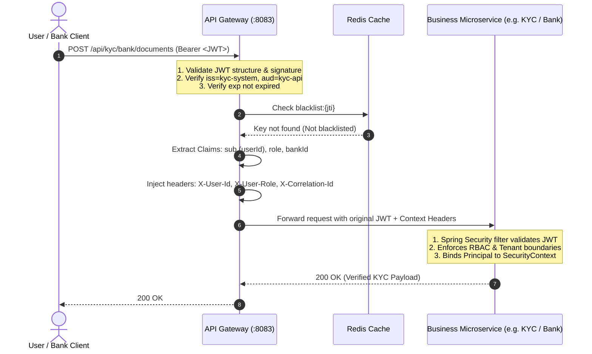

# Architecture & Trust Boundaries

**Platform**: Centralized Distributed KYC & Consent Platform  
**Architecture Model**: Zero-Trust Microservices with Defense-in-Depth  
**Revision**: 1.0 (Production Hardening)  

---

## 1. System Context & Trust Boundary Diagram

```mermaid
flowchart TD
    subgraph UntrustedZone["Untrusted External Zone"]
        ClientWeb["Web / Mobile Browser Clients"]
        BankPortal["Partner Bank Portals"]
        ExternalAttacker["Untrusted Actors / Attackers"]
    end

    subgraph PerimeterZone["Perimeter DMZ (Public Ingress)"]
        IngressTLS["Ingress Controller (TLS Termination / WAF)"]
        ApiGateway["API Gateway (Spring Cloud Gateway :8083)"]
    end

    subgraph ServiceMeshZone["Trusted Internal Microservices Zone"]
        Eureka["Discovery Service (Eureka :8761)"]
        UserSvc["User Service (:8090)"]
        BankSvc["Bank Service (:8091)"]
        ConsentSvc["Consent Service (:8084)"]
        KycSvc["KYC Management Service (:8086)"]
        DigilockerSvc["DigiLocker Adapter (:8088)"]
        EmailSvc["Email Service (:8092)"]
        NotificationSvc["Notification System (STOMP WS :8087)"]
        LogSvc["Log Monitoring System (:8085)"]
        AiSvc["AI Document / Chat Service (:8089)"]
    end

    subgraph DataZone["Isolated Data & Messaging Tier"]
        MySQL[("MySQL Cluster\n(users, kyc, consent, notification)")]
        MongoDB[("MongoDB Cluster\n(bank_customer_kyc_data)")]
        RedisCache[("Redis Cluster\n(OTP, Blacklist, WS Sessions)")]
        KafkaBroker[("Apache Kafka Cluster\n(TLS / SASL Event Streams)")]
    end

    subgraph ExternalPartnersZone["External Third-Party APIs"]
        DigiLockerAPI["Government DigiLocker OAuth2 API"]
        GroqAPI["Groq AI API (TLS HTTPS)"]
        SMTPGateway["SMTP Server (TLS Port 587)"]
    end

    %% External to Perimeter
    ClientWeb -->|HTTPS / WSS| IngressTLS
    BankPortal -->|HTTPS| IngressTLS
    ExternalAttacker -.->|Blocked Probes| IngressTLS
    IngressTLS -->|HTTP / TLS| ApiGateway

    %% Gateway to Services
    ApiGateway -->|X-User-Id, X-User-Role, JWT| UserSvc
    ApiGateway -->|X-Bank-Id, JWT| BankSvc
    ApiGateway -->|X-User-Id, JWT| ConsentSvc
    ApiGateway -->|Internal JWT| KycSvc
    ApiGateway -->|Public Session| DigilockerSvc
    ApiGateway -->|WebSocket Upgrade| NotificationSvc
    ApiGateway -->|Authenticated Proxy| AiSvc

    %% Service Registry
    UserSvc -.-> Eureka
    BankSvc -.-> Eureka
    ConsentSvc -.-> Eureka
    KycSvc -.-> Eureka
    DigilockerSvc -.-> Eureka
    EmailSvc -.-> Eureka
    NotificationSvc -.-> Eureka
    LogSvc -.-> Eureka
    AiSvc -.-> Eureka

    %% Inter-service Feign
    BankSvc -->|mTLS / Feign| UserSvc
    ConsentSvc -->|mTLS / Feign| UserSvc
    ConsentSvc -->|mTLS / Feign| BankSvc

    %% Data & Messaging Access
    UserSvc --> MySQL & RedisCache & KafkaBroker
    BankSvc --> MongoDB & RedisCache & KafkaBroker
    ConsentSvc --> MySQL & RedisCache & KafkaBroker
    KycSvc --> MySQL & RedisCache & KafkaBroker
    DigilockerSvc --> RedisCache & KafkaBroker
    EmailSvc --> KafkaBroker
    NotificationSvc --> MySQL & RedisCache & KafkaBroker
    LogSvc --> MySQL & KafkaBroker

    %% Outbound Integrations
    DigilockerSvc -->|OAuth2 HTTPS| DigiLockerAPI
    AiSvc -->|HTTPS Authorization| GroqAPI
    EmailSvc -->|STARTTLS SMTP| SMTPGateway
```



---

## 2. Trust Zones & Security Invariants

### Trust Zone 0: Untrusted External Zone (Clients & Attackers)
- **Entities**: Public end-user browsers, partner bank web frontends, public mobile applications, external network traffic.
- **Assumptions**: All incoming inputs are malicious by default. Attackers may attempt parameter tampering, injection (SQL/NoSQL/XSS), JWT forgery, brute-force OTP guessing, and unauthorized access across user identities (IDOR).
- **Controls**:
  - TLS 1.3 encryption mandatory at Ingress.
  - No direct client connectivity to internal databases, Kafka brokers, or microservices.
  - Strict Rate Limiting (Redis token-bucket) by IP and Client Fingerprint.

### Trust Zone 1: Perimeter Zone (API Gateway & Ingress)
- **Entities**: Ingress Controller (Nginx / Cloud Ingress) and Spring Cloud Gateway (`ApiGateway`).
- **Responsibilities**:
  - Centralized authentication gatekeeper.
  - JWT signature, issuer, audience, and expiration verification.
  - Centralized revocation check: querying Redis for blacklisted JWT IDs (`jti`).
  - Mutual TLS (mTLS) / trusted network boundary to downstream services.
  - Context header injection: `X-User-Id`, `X-User-Role`, `X-Bank-Id`, and `X-Correlation-Id`.
- **Security Invariant**: Any request that fails authentication or role policy must be rejected at the gateway with an RFC 7807 error. Under **no** circumstance should unauthenticated requests be proxied to internal business services.

### Trust Zone 2: Trusted Internal Microservices Zone
- **Entities**: `UserService`, `BankService`, `ConsentService`, `KycManagementService`, `DigilockerService`, `EmailService`, `NotificationSystem`, `LogMonitoringSystem`, `AiService`, `DiscoveryService`.
- **Zero-Trust Principle within the Service Mesh**:
  - Internal microservices **must not** blindly trust incoming HTTP headers without token verification.
  - Every service hosting sensitive domain data (`UserService`, `KycManagementService`, `BankService`, `ConsentService`) must run Spring Security with a shared cryptographic validation filter.
  - Inter-service REST communication via OpenFeign must transmit a signed internal service token or propagate user credentials.
  - Tenant isolation: Bank agents can only access records associated with their authenticated `bankId`.

### Trust Zone 3: Isolated Data & Messaging Tier
- **Entities**: MySQL, MongoDB, Redis, and Apache Kafka.
- **Network Isolation**: Accessible **only** from within the private Kubernetes pod CIDR via explicit Kubernetes `NetworkPolicy` objects. No public NodePort or LoadBalancer access.
- **Storage-at-Rest Security**:
  - Relational tables containing PII (`first_name`, `last_name`, `phone`, `aadhaar_no`, `pan`, `driving_license`, `address`) are encrypted at the field level via AES-256-GCM.
  - MongoDB documents containing aggregated verification data (`bank_customer_kyc_data`) must store encrypted attributes.
  - Kafka topics carrying KYC events must employ TLS transport and SASL/SCRAM authentication.

### Trust Zone 4: External Integrations (Third-Party APIs)
- **Entities**: DigiLocker, Groq AI API, SMTP Server.
- **Controls**:
  - Secrets (API Keys, SMTP passwords) injected strictly via environment variables or secret vaults.
  - Strict HTTP connection and read timeouts (e.g., connect timeout 3s, read timeout 5s).
  - Resilience4j Circuit Breakers to prevent cascading failures if an external provider stalls.

---

## 3. JWT Trust Model & Context Propagation



### Required JWT Claims Specification
```json
{
  "iss": "https://auth.kyc-system.com",
  "sub": "3fa85f64-5717-4562-b3fc-2c963f66afa6",
  "aud": "https://api.kyc-system.com",
  "typ": "ACCESS",
  "role": "USER",
  "bankId": null,
  "jti": "d3b07384-d113-4660-9ff9-72f10b74102e",
  "iat": 1731920000,
  "exp": 1731923600
}
```

---

## 4. Attack Vectors & Defensive Controls Matrix

| Attack Vector | Vulnerable Component in Legacy Code | Hardened Defensive Control |
| :--- | :--- | :--- |
| **Authentication Bypass** | `ApiGateway/JwtFilter.java` permitted requests with missing auth headers to pass through downstream. | Gateway rejects unauthenticated requests on protected routes with 401; downstream services run independent JWT security filters. |
| **Privilege Escalation** | `UserServiceImpl.java` accepted desired `role` directly from user request DTO during OTP verification. | Roles are fetched strictly from the persistent `UserEntity` record in MySQL. Client input cannot override roles. |
| **IDOR / Tenant Breach** | `BankConsentController` returned all approved consents across all banks without bank isolation. | Endpoints inspect the authenticated principal's `bankId` and strictly scope repository queries to that tenant. |
| **Signature Forgery** | `KycManagementService/JwtParserUtil` decoded JWT payload using Base64 without signature check. | Replaced with standard JJWT verification parser enforcing HMAC-SHA256 signature verification against active secret key. |
| **OTP Brute-Force** | 10-minute validity window with 0 rate limiting or maximum attempts check. | Maximum 3 failed attempts per OTP in Redis; 3-minute TTL; IP-based rate limiting on verify endpoints. |
| **PII / Secret Leakage** | Plaintext OTPs logged via SLF4J and `System.out`; email/phone sent to log topics. | Removal of all `System.out` and sensitive log statements; implementation of custom Logback masking patterns for PII. |
| **Denial of Service** | Unbounded `RestTemplate` and Feign calls without timeout; unbounded in-memory database queries (`repo.findAll()`). | Resilience4j circuit breakers, strict 3s HTTP timeouts, and mandatory `Pageable` pagination across all search/list endpoints. |
